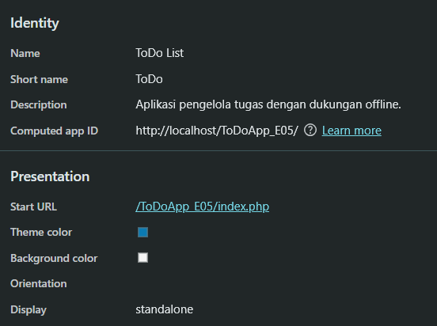
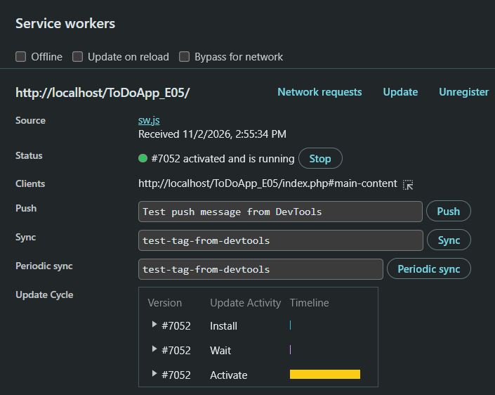
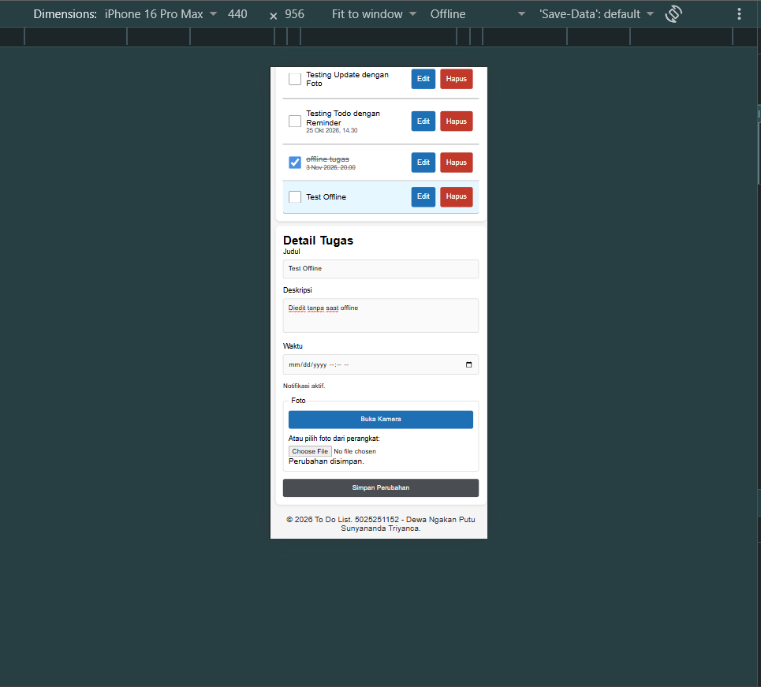

# [E06] The Endpoint of Portals — ToDo App

## Identitas
- Nama : Dewa Ngakan Putu Sunyananda Triyanca
- NRP : 5025251152
- Kelas : Pemrograman Web (A)

## Deskripsi
Aplikasi ToDo berbasis PHP dan MySQL yang mengembangkan PWA E05 dengan REST API untuk pengelolaan tugas. Aplikasi dapat dipasang, dibuka tanpa jaringan setelah kunjungan awal, serta menyimpan perubahan secara lokal sebelum disinkronkan ke server.

CRUD tugas langsung menggunakan satu resource REST, `api/todos.php`. Endpoint sinkronisasi antrean offline (`api/sync_todo.php`) dan endpoint unggah foto (`api/upload_photo.php`) tetap terpisah karena menangani alur khusus.

### Daftar Endpoint

| Metode | Endpoint | Fungsi | Respons sukses |
|---|---|---|---:|
| GET | `/api/todos.php?type=personal` | Membaca daftar Personal | 200 OK |
| GET | `/api/todos.php?type=shared` | Membaca daftar Shared | 200 OK |
| GET | `/api/todos.php?id={id}` | Membaca detail tugas yang dapat diakses | 200 OK |
| POST | `/api/todos.php` | Membuat tugas | 201 Created |
| PATCH | `/api/todos.php?id={id}` | Memperbarui sebagian field tugas Personal | 200 OK |
| PUT | `/api/todos.php?id={id}` | Memperbarui data tugas | 200 OK |
| DELETE | `/api/todos.php?id={id}` | Menghapus tugas Personal | 204 No Content |

Contoh body untuk membuat tugas:

```json
{
  "title": "Belajar REST API",
  "description": "Menguji endpoint tugas",
  "task_type": "personal",
  "due_date": null,
  "image_path": null
}
```

Contoh body untuk PATCH:

```json
{
  "title": "Belajar REST API",
  "description": "Endpoint sudah diuji",
  "completed": true
}
```

Respons GET, POST, dan PATCH menggunakan JSON dengan properti `success` dan `data`. DELETE yang berhasil mengembalikan `204 No Content` tanpa body.

### Kode Respons Error

| Status | Kode contoh | Kondisi |
|---:|---|---|
| 400 Bad Request | `invalid_json`, `title_required`, `invalid_type` | JSON, parameter, atau data tidak valid |
| 403 Forbidden | `forbidden` | Tugas tidak boleh diubah/dihapus oleh akses demo saat ini |
| 404 Not Found | `todo_not_found` | ID tugas tidak ditemukan atau tidak dapat diakses |
| 405 Method Not Allowed | `method_not_allowed` | Metode HTTP tidak didukung |
| 500 Internal Server Error | `database_error`, `internal_error` | Database atau server mengalami kesalahan |

Contoh respons error:

```json
{
  "success": false,
  "error": {
    "code": "title_required",
    "message": "title wajib diisi."
  }
}
```

### Hasil Pengujian Manual

Pengujian dilakukan melalui aplikasi di Chrome DevTools dan request langsung ke API untuk memeriksa validasi server.

| Skenario | Status | Hasil |
|---|---:|---|
| Membaca daftar tugas Personal | 200 | Berhasil |
| Membuat tugas valid | 201 | Berhasil |
| Memperbarui tugas | 200 | Berhasil |
| Menghapus tugas | 204 | Berhasil |
| Mengirim judul kosong langsung ke API | 400 | Berhasil; kode `title_required` |
| Meminta ID tugas yang tidak ditemukan | 404 | Berhasil; kode `todo_not_found` |
| Mengirim metode `OPTIONS` | 405 | Berhasil; kode `method_not_allowed` |
| Membuka aplikasi saat koneksi MariaDB belum tersedia | 500 | Terlihat di log; setelah MariaDB XAMPP dijalankan, request daftar kembali 200 |

Pemeriksaan 400 dilakukan langsung terhadap API karena form antarmuka mewajibkan judul sebelum mengirim request. Kegagalan koneksi database dicatat di log Apache/PHP, respons 500 tidak dibuat dengan mengubah atau mematikan database saat pengujian.


### Fitur Utama
- **Personal ToDo :** tambah, baca, edit, tandai selesai/belum selesai, dan hapus tugas.
- **Shared ToDo :** tambah dan baca tugas bersama. Edit, hapus, dan perubahan status tetap dinonaktifkan sesuai pada E04.
- **PWA :** manifest, ikon PNG 192 × 192 dan 512 × 512, serta tampilan `standalone`.
- **Tombol instalasi :** menggunakan `beforeinstallprompt`, disembunyikan sampai browser menyediakan prompt dan setelah aplikasi terpasang.
- **Offline :** precache tampilan dasar aplikasi, CSS, JavaScript, manifest, ikon, dan halaman cadangan.
- **Penyimpanan lokal :** tugas dan perubahan yang belum dikirim disimpan dalam IndexedDB.
- **Sinkronisasi :** antrean dikirim ke PHP/MySQL ketika koneksi tersedia dan aplikasi terbuka.
- **Pencegahan tugas ganda :** setiap operasi mempunyai ID unik yang dicatat di server agar pengiriman ulang tidak memproses operasi yang sama dua kali.
- **Foto tugas :** pilih foto atau ambil melalui kamera, foto baru dapat disimpan lokal sebelum diunggah saat sinkronisasi.
- **Tema dan aksesibilitas :** mode terang/gelap, label form, navigasi keyboard, serta tampilan responsif.
- **Pengingat :** menggunakan Web Notifications API, pemeriksaan jadwal berjalan ketika halaman aplikasi aktif/terbuka.

## Dokumentasi Pengerjaan
### 1. Manifest



### 2. Service Worker aktif



### 3. Cache Storage


### 4. Aplikasi saat offline



### 5. Antrean sebelum sinkronisasi


### 6. Antrean setelah sinkronisasi


### 7. Halaman cadangan offline


### 8. Aplikasi terpasang


### 9. Percobaan REST API

